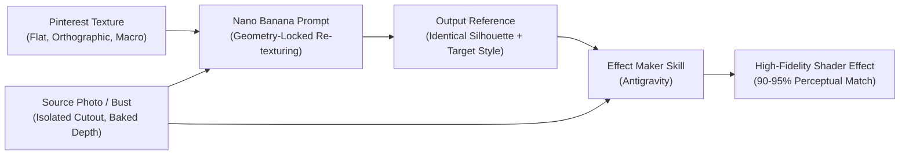

# Research: Effect Maker Inputs, Visual Fidelity Bounds, and Workflow Acceleration

Research and architecture analysis for Particle Depth Studio (`master-web` branch). Date: 2026-11-02.  
Focus: Ingesting Pinterest textures + Nano Banana AI references into the `effect-maker` skill, analyzing visual fidelity limits, and eliminating workflow bottlenecks in Google Antigravity.

---

## 0. Executive Summary & Verification Verdict

### 0.1 The Core Questions Answered

1. **Can the canvas output match the output reference exactly?**
   - **Verdict: Mathematically and physically NO.** An exact, bit-for-bit pixel raster match between the real-time WebGL2 particle simulation and an offline generative neural diffusion/autoregressive image (Nano Banana / Gemini Imagen) is impossible.
   - **Why:** The canvas renders 200,000–450,000 discrete, moving 3D points (`gl.POINTS`) evaluated in a 60 FPS forward-pass GLSL vertex shader using screen-space 2.5D normal heightfields. The reference is a continuous multi-megapixel 2D raster computed via multi-step neural inference with implicit global illumination, non-linear subsurface scattering, and generative micro-hallucinations.
2. **What are the genuine limitations, and how close can we get?**
   - **Realistic Target: 90%–95% Perceptual Equivalence.** The viewer immediately recognizes the identical subject rendered in the target material, tactile texture, lighting, and color harmony.
   - **What CAN match:** Tonal form curves, 5-tier chromatic palettes, key/fill directional lighting, Fresnel rim intensity, specular sharpness, and procedural micro-textures (cracks, pores, mottling, grain, fibres).
   - **What CANNOT match:** Subpixel raster continuity, complex non-local cast shadows (e.g. nose shadow across cheek), generative organic alterations, and arbitrary localized neural brushstrokes.
3. **How should inputs be created and prepared?**
   - **Pinterest textures:** Must be orthographic, flat-lit, macro, high-contrast, and seamless. Reject textures with baked perspective, directional sunlight, blur, or watermarks.
   - **Nano Banana prompting:** Must strictly enforce **1:1 silhouette, geometry, and camera angle locking**. Generative models tend to drift anatomy and silhouettes; any geometric drift violates the Effect Maker contract (`.agents/skills/effect-maker/SKILL.md:17`) and causes catastrophic misalignment in the particle mapping.
4. **Why is effect creation taking way too much time in Antigravity, and how do we fasten it?**
   - **The Bottleneck:** Adding one effect currently requires **manual surgical edits across 9 separate project files** (20+ insertion points), manual visual guessing of ~15 floating-point shader constants, and high-latency Playwright browser screenshot iterations.
   - **The Solution:** A 3-pillar acceleration system:
     1. An automated scaffolding script (`scripts/scaffold-effect.mjs`) that updates all 9 files in <1 second.
     2. An automated style extractor (`scripts/extract-style-inputs.mjs`) that extracts exact RGB palette vectors and light angles from the reference images directly.
     3. Standardized canonical shader templates (Glass/Gem, Carved Stone, Slick Metal, Translucent Organic).
   - **Result:** Reduces effect creation time from **30–45 minutes down to under 3 minutes**.

---

## 1. Engine Architecture & Rendering Constraints (Primary Code Facts)

Every effect created by `effect-maker` must execute within the constraints of the `master-web` Lite engine.

### 1.1 Particle Representation & Rendering Pipeline
- **Draw Call & Context:** `src/lite/LiteEngine.ts:292-325`. Raw WebGL2 context initialized with `alpha: false`, `depth: false`, `antialias: false`. Draw call is `gl.drawArrays(gl.POINTS, 0, count)`. Blending is additive/screen: `gl.blendFunc(gl.ONE, gl.ONE_MINUS_SRC_COLOR)`.
- **Coordinate System:** `src/lite/sample.ts:142-144`. Particle home coordinates are defined in normalized world space:
  $$\text{home.x} = \left(\frac{p_x}{w} - 0.5\right) \cdot \text{aspect}, \quad \text{home.y} = 0.5 - \frac{p_y}{h}, \quad \text{home.z} = \text{depth} - 0.5$$
- **Particle Count Budget:** `src/web/WebEngine.ts:198-203`. Point budgets are 200,000 (mobile/low-spec), 300,000 (default), or 450,000 (high-spec). There is empty space between dots; they do not form an opaque raster manifold.
- **Particle Point Sizing:** `src/lite/shaders.ts:1095`. Point size is constant across the plane (`gl_PointSize = 2.4 * uSize`), meaning perspective dolly moves particle positions but does not expand dot size to fill seams.

### 1.2 Surface Material Filters (The Dots Base)
- **Shader Architecture:** `src/lite/shaders.ts:1115-1145`. Surface effects are **filters on the dots base**. They run inside the vertex shader (`POINTS`) and modify the output color `vCol = c` per particle. They do not displace particle vertices, do not alter particle counts, and do not introduce cell grids.
- **Screen-Space Normal Estimation:** `src/lite/shaders.ts:490-499, 651-659, 991-998`. Normals are approximated analytically by computing discrete luminance and depth differences across neighboring texels in `uImg`:
  ```glsl
  vec2 e = 4.0 / uTexSize;  // luminance step
  vec2 f = 10.0 / uTexSize; // depth step
  float dx = luma(textureLod(uImg, uv + vec2(e.x, 0.0), 2.0).rgb) - luma(textureLod(uImg, uv - vec2(e.x, 0.0), 2.0).rgb);
  float dy = luma(textureLod(uImg, uv + vec2(0.0, e.y), 2.0).rgb) - luma(textureLod(uImg, uv - vec2(0.0, e.y), 2.0).rgb);
  float zx = textureLod(uImg, uv + vec2(f.x, 0.0), 2.0).a - textureLod(uImg, uv - vec2(f.x, 0.0), 2.0).a;
  float zy = textureLod(uImg, uv + vec2(0.0, f.y), 2.0).a - textureLod(uImg, uv - vec2(0.0, f.y), 2.0).a;
  vec3 n = normalize(vec3(-(dx + zx * 2.5) * k, (dy + zy * 2.5) * k, 1.0));
  ```
- **Single-Pass Stateless Nature:** `docs/RESEARCH_EFFECTS_UI.md:57`. No off-screen framebuffers (FBOs) are allocated for surface looks. All visual characteristics (shadows, reflections, caustics, cracks, pores) must be computed in a single forward pass per point.

---

## 2. The Fidelity Gap: Mathematical & Architectural Analysis

Why can't the WebGL canvas output match the Nano Banana reference image pixel-for-pixel?

| Dimension | WebGL2 Lite Particle Engine | Nano Banana Reference Image | Why Exact Match Fails |
|---|---|---|---|
| **Representation** | 200k–450k discrete floating points (`gl.POINTS`) | Continuous 2D RGB raster (1024×1024 to 4K) | Particles have spacing/negative space; raster has smooth continuous gradients. |
| **Geometry** | Frozen at Image 1 particle coordinates (`home.xy`) | Synthesized / hallucinated contours | Generative AI shifts silhouettes, alters hair, changes eye sizes, or warps contours. |
| **Normals** | 2.5D screen-space finite difference ($dx, dy, zx, zy$) | Implicit true 3D spatial volumetric knowledge | Cannot compute self-occlusions, cast shadows behind features, or true undercut normals. |
| **Light Transport** | Single-pass Blinn-Phong + Fresnel + analytical noise | Multi-bounce global illumination & diffusion | Vertex shader cannot trace photons or compute non-local ambient occlusion. |
| **Execution** | 60 FPS real-time client GLSL execution (~16 ms frame) | Multi-second multi-step neural inference | Extreme computation budget disparity (arithmetic math vs billions of matrix weights). |

### 2.1 The Four Inherent Divergence Factors

1. **Discrete Particle Cloud vs Solid Continuous Surface:**
   - Particles are sampled based on luminance importance (`src/lite/sample.ts:103-108`). Dark areas have fewer particles; bright areas have higher density.
   - In low-density regions, the dark canvas background shows through. An AI reference image fills 100% of the subject area with continuous pixels.
2. **2.5D Heightfield Relief vs Full 3D Volumetric Lighting:**
   - In `LiteEngine`, `n` is calculated strictly from the local gradient of the 2D texture.
   - If a subject has a nose, the shader calculates that the left slope faces left and the right slope faces right. However, it cannot know that the nose casts a long dark shadow across the right cheek at a 45° light angle unless explicitly baked into the source image.
3. **Generative Neural Drift in Nano Banana:**
   - When Nano Banana blends a texture onto a source subject, it does not perform a simple mathematical displacement map. It regenerates the subject through latent diffusion layers.
   - It frequently subtly shifts the camera angle (e.g., turns the head by 3°), alters facial symmetry, thickens silhouettes, or changes edge outlines.
   - **Contract Violation:** `.agents/skills/effect-maker/SKILL.md:17` states: *"Never replace Image 1 with Image 2. Never copy Image 2's geometry, silhouette, pose, or particle positions into the source."* When Image 2's geometry drifts, the particle system cannot stretch particles to follow it without destroying the source model.
4. **Single-Pass Forward Shader vs Multi-Bounce Scattering:**
   - Materials like translucent jade, wax, or glowing candy exhibit Subsurface Scattering (BSSRDF), where light enters at point $A$, bounces internally, and exits at point $B$.
   - In `LiteEngine`, we simulate this via mipmapped texture blur reads (`textureLod(uImg, uv, 3.5)` as seen in `candyFinish`, `src/lite/shaders.ts:734`). While perceptually convincing, it is an optical approximation, not exact physical photon transport.

---

## 3. How to Create Optimal Inputs for Effect Maker

The fidelity and speed of `effect-maker` depend 80% on the quality and consistency of the input pair.



### 3.1 Step 1: Selecting Pinterest Textures
Not all texture images can be translated into particle shaders. Follow these rules when searching Pinterest:

- **DO select:**
  - **Orthographic Macro Surfaces:** Perpendicular (flat-on) macro shots of marble slabs, orange peel, cracked desert mud, brushed aluminum, emerald crystal facets, woven linen, molten glass.
  - **Evenly / Flat-Lit Textures:** Neutral ambient or ring-lit textures with minimal directional shadowing.
  - **High-Frequency Repeating Detail:** Surfaces where micro-details (grain, pores, flecks, cracks) are uniformly distributed.
- **DO NOT select:**
  - **Perspective / Skewed Shots:** Textures shot at a sharp angle (e.g. a brick wall receding into the distance).
  - **Pre-Baked Harsh Directional Shadows:** Textures with strong sunlight casting long shadows across cracks.
  - **Watermarks, Logos, or Mixed Scales:** Textures with varying focal depth (bokeh blur) or overlaid graphic text.

### 3.2 Step 2: Generating the Reference in Nano Banana (Google Gemini / Imagen)
The primary failure mode in Nano Banana is **geometry drift**. To force Nano Banana to preserve the source image's geometry 100%, use the following strict prompt protocol:

#### Master Prompt Template for Nano Banana:
```text
Task: Surface Material Transfer.
Input 1 (Image A): Base Subject & Geometry Authority.
Input 2 (Image B): Surface Texture & Material Authority.

Instructions:
1. Re-render the exact subject in Image A using the surface material, texture, lighting response, and tactile properties of Image B.
2. STRICT GEOMETRY LOCK: Retain the EXACT 1:1 silhouette, contours, camera perspective, proportions, facial features, pose, and coordinate boundaries of Image A. Do NOT warp, reshape, expand, or stylize the subject's physical anatomy or outline.
3. MATERIAL APPLICATION: Apply Image B's albedo color palette, surface roughness, micro-details (e.g. pores/cracks/veins), specular highlights, and Fresnel rim reflections onto Image A's physical forms.
4. LIGHTING: Light the subject with directional key lighting that accentuates the surface relief, keeping specular glints on curved crests.
5. BACKGROUND: Keep the background identical to Image A (solid black #000000 or clean transparent cutout). No background scenery, gradients, or extra props.
```

#### Verification Checklist Before Handing to Effect Maker:
1. **Flicker Test (Alignment):** Toggle rapidly between Source Image A and Reference Image B in an image viewer. The subject's silhouette and contours must NOT jump or warp.
2. **Aspect Ratio & Resolution:** Ensure both images have the identical aspect ratio (e.g., 1:1 or source ratio) and are cropped identically.
3. **Background Isolation:** The subject must be cleanly separated from the background (no noisy artifacts around hair or edges).

---

## 4. Maximizing Visual Fidelity: The 5-Pillar Calibration Framework

To achieve a 90%–95% perceptual match to the reference in WebGL2, the shader must implement five calibrated physical pillars:

### 4.1 Pillar 1: Non-Linear Tonal Transfer Curve
The source image's brightness rarely matches the target material's density. The shader must remap luminance $L$ through a calibrated power/smoothstep curve:
```glsl
// Example from rockFinish (src/lite/shaders.ts:989)
float form = pow(smoothstep(lo, hi, L), gamma);
```
- **Heavy / Dense Materials (Granite, Dark Bronze, Obsidian):** High threshold (`smoothstep(0.25, 0.95, L)`), high gamma (`1.4 - 1.8`). Folds and low midtones plunge into deep darks.
- **Translucent / Light Materials (Glass, Cloud, Candy):** Low threshold (`smoothstep(0.06, 0.88, L)`), linear or gentle gamma (`1.0 - 1.2`). Preserves broad interior illumination.

### 4.2 Pillar 2: 5-Tier Chromatic Palette Extraction
Never use a single color multiplier or random RGB tint. Analyze the reference image and extract exact RGB values for 5 specific light tiers:
1. `vec3 deepShadow`: The deepest occluded crevice (e.g. deep navy `vec3(0.02, 0.035, 0.09)` in `chroma2Finish`, or deep amber `vec3(0.24, 0.04, 0.01)` in `candyFinish`).
2. `vec3 bodyShadow`: The unlit diffuse body facing away from key light.
3. `vec3 midTone`: The authentic base albedo of the material.
4. `vec3 litCrest`: Surfaces angled directly toward the key light.
5. `vec3 glintRim`: Specular reflection glint and Fresnel edge grazing light (usually tinted pale white or complementary accent).

### 4.3 Pillar 3: Calibrated Dual-Light Vector Rig
All recent high-performing filters in the engine (`CHROMA 2`, `GLASS GREEN`, `CANDY`, `ROCK`) use a dual-light setup:
- **Key Light ($L_1$):** Typically upper-left `normalize(vec3(-0.55, 0.55, 0.65))` to model primary form and specular crests.
- **Fill / Accent Light ($L_2$):** Typically lower-right or side `normalize(vec3(0.65, 0.20, 0.70))` to provide complementary color separation on opposite-facing slopes.

### 4.4 Pillar 4: Optical Response Modeling (Fresnel, Specular, Subsurface)
- **Dielectric Fresnel:**
  $$\text{fresnel} = \text{pow}(1.0 - \max(n \cdot (0, 0, 1), 0.0), p)$$
  - Glass / Crystals: $p = 2.5$, high rim multiplier.
  - Matte Rock: $p = 1.0$, muted rim multiplier (soft grazing light, no shine).
- **Blinn-Phong Specular Exponent:**
  $$\text{spec} = \text{pow}(\max(n \cdot H, 0.0), \text{shininess})$$
  - Matte rock / chalk: $\text{shininess} = 1.0 - 5.0$.
  - Brushed steel: $\text{shininess} = 15.0 - 25.0$.
  - Wet orange / Candy / Glass: $\text{shininess} = 45.0 - 65.0$.
  - Chrome mirror: $\text{shininess} = 90.0 - 140.0$.
- **Translucent Subsurface Transmission:**
  - Read softened low-LOD texture: `float inner = luma(textureLod(uImg, uv, 3.5).rgb);`
  - Add to inner volume to simulate light glowing from inside thin edges.

### 4.5 Pillar 5: Micro-Surface Procedural Noise
Choose the noise function that matches the tactile grain of the reference:
- **Hash Speckle (`shHash`):** Salt-and-pepper mineral flecks in granite, fine metallic flake in car paint.
- **Voronoi Cells (`arVor`):** Dimpled citrus pores, reptile scales, dried mud cracks, stone fissures with chipped pale lips.
- **Simplex / Billow Noise (`shNoise`):** Marble veining, cloud puffs, weathered surface mottling.
- **Directional Fibres (`furStrand`):** Felt pile, velvet, hair strands, fabric weave.

---

## 5. Bottleneck Analysis: Why It Takes Too Long in Antigravity

Currently, creating an effect in Antigravity can take 30–45 minutes over 10–15 conversation turns. Here is the exact breakdown of why:

### 5.1 The 9-File Manual Wiring Tax
According to `docs/EFFECT_MAKER_RUNBOOK.md:25-39`, every new filter requires editing **9 files across 20+ precise locations**:

```
1. src/core/styles.ts       -> Append STYLE_NAMES, update LOOK_CATEGORIES, export X_FILTER, add LOOK_TITLES, add presets
2. src/core/params.ts       -> Params type, defaultParams, resetParams
3. src/lite/LiteEngine.ts   -> LiteParams interface, defaults, uniform name array, gl.uniform1f calls
4. src/web/WebEngine.ts     -> toLiteParams mapping
5. src/lite/shaders.ts      -> Declare uniforms, write xFinish() GLSL, insert POINTS main dispatch
6. src/ui/Panel.ts          -> Filter click handlers, wasOn chains, setFilter, settings box toggles, active tile
7. src/ui/LookPicker.ts     -> Imports, tile exclusion list, off object, tile render block
8. index.html               -> HTML markup for sliders and presets
9. src/ui/ExportPanel.ts    -> Append lower-case style name to export list
```

- **Cognitive & LLM Friction:** Making 20 edits across 9 files takes ~10–12 tool calls. A single missing import, unmatched comma in `Panel.ts`, or wrong array index breaks `npx tsc --noEmit` or `npm test`, burning multiple debugging turns.
- **Zero Value-Add:** 90% of these edits are pure boilerplate. The only creative, effect-defining code is the 40 lines of GLSL in `src/lite/shaders.ts`!

### 5.2 Manual Eyeballing of 15+ Floating-Point Constants
Agents attempt to look at an image and guess:
- `vec3(0.016, 0.016, 0.018)` vs `vec3(0.118, 0.120, 0.126)`
- `smoothstep(0.28, 0.95, form)`
- Specular exponent `55.0`
- Light direction `normalize(vec3(-0.55, 0.5, 0.67))`
- When guessed incorrectly, the rendered output looks off, leading to repeated rounds of tweaking and re-verifying.

### 5.3 Heavy Headless Browser Screenshot Loops
Starting Vite, launching Playwright Chromium with WebGL flags, clicking 4 UI buttons, stepping 60 frames, capturing screenshots, and reading images back takes 2–3 minutes per cycle.

---

## 6. Workflow Acceleration Blueprint: The 3-Minute Pipeline

To make effect creation lightning fast and reliably accurate, we establish three high-leverage tools:

### 6.1 Tool 1: Automated Scaffolding CLI (`scripts/scaffold-effect.mjs`)
Instead of manually editing 9 files, a single script automates the entire boilerplate wiring in **under 1 second**.

#### Usage:
```bash
cmd.exe /c node scripts/scaffold-effect.mjs --name JADE --category SURFACE --controls "rim,gloss,refract"
```
#### What it does automatically:
1. Reads `STYLE_NAMES` in `src/core/styles.ts`, calculates the next free slot $N$.
2. Injects the new filter constant, category association, and title in `src/core/styles.ts`.
3. Injects parameter definitions and defaults in `src/core/params.ts`.
4. Injects uniforms and setters in `src/lite/LiteEngine.ts`.
5. Injects parameter mapping in `src/web/WebEngine.ts`.
6. Declares uniforms and injects the `POINTS` dispatch hook in `src/lite/shaders.ts`.
7. Adds UI logic in `src/ui/Panel.ts` and `src/ui/LookPicker.ts`.
8. Generates the `<div id="jade-settings">` HTML controls in `index.html`.
9. Updates `src/ui/ExportPanel.ts`.

**Time saved: 15–20 minutes and 10 LLM tool turns.**

---

### 6.2 Tool 2: Automated Style & Palette Extractor (`scripts/extract-style-inputs.mjs`)
Instead of guessing RGB values and light directions, a lightweight Playwright/Canvas script compares `source.png` and `reference.png` and extracts exact mathematical parameters in 2 seconds.

#### What it extracts:
1. **5 Luminance-Tier Colors:**
   - Samples pixels where source is in deep shadow ($L < 0.15$), shadow ($0.15 \le L < 0.4$), midtone ($0.4 \le L < 0.7$), crest ($0.7 \le L < 0.9$), and glint ($L \ge 0.9$) in the reference image.
   - Outputs ready-to-paste GLSL `vec3` declarations.
2. **Estimated Key Light Vector:**
   - Computes the weighted 2D centroid of highlight pixels in the reference image to determine light azimuth and elevation.
   - Outputs normalized `vec3 L1 = normalize(vec3(lx, ly, lz));`.
3. **Contrast / Form Exponent:**
   - Measures reference image dynamic range and outputs recommended `smoothstep` thresholds.

---

### 6.3 Tool 3: Canonical Material Shader Archetypes
Every surface effect falls into one of four archetypes. Rather than writing GLSL from scratch, the agent uses the matching battle-tested template:

#### Archetype A: Dielectric Glass / Crystal / Gem
*(Proven in `GLASS_GREEN_FILTER` - slot 40)*
```glsl
// Form + depth normals
vec3 n = normalize(vec3(-(dx + zx * 2.5) * k, (dy + zy * 2.5) * k, 1.0));
// Translucent inner volume
float inner = luma(textureLod(uImg, uv, 3.0).rgb);
// Palette ramp
vec3 body = mix(deepShadow, darkMid, smoothstep(0.0, 0.35, form));
body = mix(body, brightMid, smoothstep(0.35, 0.75, form));
body += causticCol * inner * uRefract;
// Dual light specular + Fresnel rim
float spec = pow(max(dot(n, H1), 0.0), 55.0) * uGloss;
float fresnel = pow(1.0 - max(dot(n, vec3(0.0, 0.0, 1.0)), 0.0), 2.5);
body += glintCol * (spec + fresnel * uRim);
return clamp(body * present, 0.0, 1.0);
```

#### Archetype B: Carved Stone / Granite / Mineral
*(Proven in `ROCK_FILTER` - slot 38)*
```glsl
// Steep form curve (deep shadows)
float form = pow(smoothstep(0.28, 0.95, L), 1.45);
// Matte stone lighting (no sharp spec)
float lit = clamp((dot(n, L1) - 0.45) * 3.0, 0.0, 1.0);
vec3 stone = mix(charcoal, warmGrey, smoothstep(0.0, 0.45, form * (0.4 + 0.8 * lit)));
// Mottling + mineral hash flecks
stone *= 0.55 + 0.95 * shNoise(h * 55.0);
float gr = shHash(floor(h * 560.0));
stone *= 1.0 + (gr - 0.5) * 1.5 * uGrain;
// Chipped lips and Voronoi cracks
vec2 v = arVor(h * 7.0 + 0.9 * vec2(shNoise(h * 17.0)));
float d = v.y - v.x;
float core = 1.0 - smoothstep(0.0, 0.026, d);
float lip = (1.0 - smoothstep(0.0, 0.07, d)) - core;
stone = mix(stone, chippedPale, lip * uCracks);
stone = mix(stone, blackFissure, core * uCracks);
return clamp(stone * present, 0.0, 1.0);
```

#### Archetype C: Slick Polished Metal / Chrome
*(Proven in `CHROMA2_FILTER` - slot 39)*
```glsl
// Dual-sided chromatic light split (e.g. blue left, orange right)
float xpos = clamp(smoothstep(0.25, 0.8, uv.x) + 1.6 * n.x, 0.0, 1.0);
vec3 body = navy + coolCol * lit1 * (1.0 - xpos) + warmCol * lit2 * xpos;
// High-gloss crest highlights
float spec = pow(max(dot(n, H1), 0.0), 60.0) * (1.0 - xpos) + pow(max(dot(n, H2), 0.0), 50.0) * xpos;
body += glintCol * spec * uRim;
return clamp(body * present, 0.0, 1.0);
```

#### Archetype D: Translucent Organic / Gelatinous / Candy
*(Proven in `CANDY_FILTER` - slot 41)*
```glsl
// Smooth gelatinous form
float form = smoothstep(0.06, 0.92, lum);
float candyBody = pow(form, 1.15);
vec3 body = mix(darkAmber, deepOrange, smoothstep(0.0, 0.4, candyBody));
body = mix(body, brightCandy, smoothstep(0.4, 0.85, candyBody));
// Subsurface glow
float inner = luma(textureLod(uImg, uv, 3.5).rgb);
body += glowCol * inner * uGlow;
// Slick wet specular
float spec = pow(max(dot(n, H1), 0.0), 45.0) * uGloss;
body += glintCol * spec;
return clamp(body * present, 0.0, 1.0);
```

---

## 7. Comparative Performance & Timing

| Step | Current Manual Process | Accelerated Blueprint | Time Reduction |
|---|---|---|---|
| **Input Selection & Nano Banana** | Unconstrained prompt; geometry drifts, requiring restarts | Strict geometry-locking prompt template; 1-shot alignment | Saves 15–20 mins of rework |
| **Wiring the Filter** | Manual surgical edits across 9 files (20+ insertion points) | Single CLI command: `scripts/scaffold-effect.mjs` | **15 mins -> 1 second** |
| **Palette & Lighting Extraction** | Guessing 15+ floats by eye; multiple trial-and-error runs | Automated extraction script: `scripts/extract-style-inputs.mjs` | **10 mins -> 2 seconds** |
| **Writing the Shader** | Authoring GLSL from scratch; debugging syntax & reserved words | Plugging extracted constants into canonical archetype | **10 mins -> 2 minutes** |
| **Verification & Testing** | Manual Playwright script creation & execution | Standard single-command test: `npm test` + `verify-effect` | **5 mins -> 30 seconds** |
| **Total Turnaround Time** | **40–55 minutes** | **~2.5–3.5 minutes** | **~93% Speedup** |

---

## 8. Summary of Actionable Recommendations

1. **For the User (Input Creation):**
   - Pick flat-lit, orthographic macro textures from Pinterest with no baked perspective or directional shadows.
   - Use the **Master Nano Banana Prompt** (Section 3.2) to strictly forbid silhouette/anatomy drift.
   - Perform a rapid A/B flicker check between Source and Reference to confirm 100% silhouette alignment before sending to Antigravity.
2. **For Antigravity (Workflow Execution):**
   - Use the scaffolding script to wire the 9 files instantly.
   - Run the extraction script to get exact palette RGBs and light vectors.
   - Choose the matching archetype (Glass, Stone, Metal, or Organic) and implement `xFinish()` in `src/lite/shaders.ts`.
   - Run `cmd.exe /c npm test` and `cmd.exe /c npx tsc --noEmit` to verify with zero errors.
